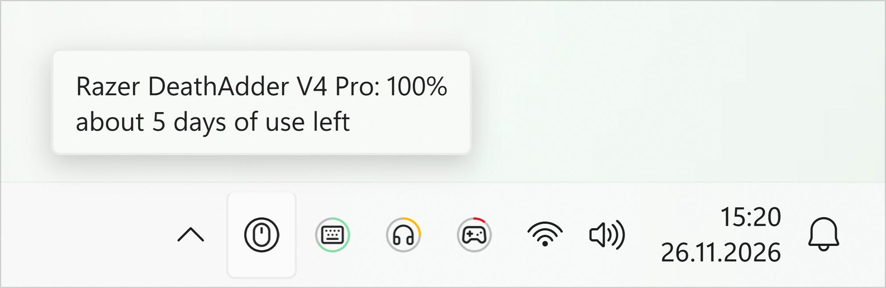
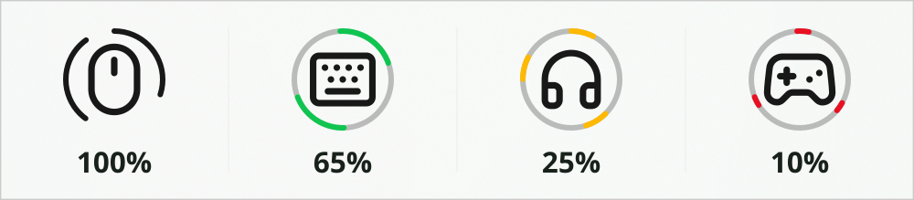
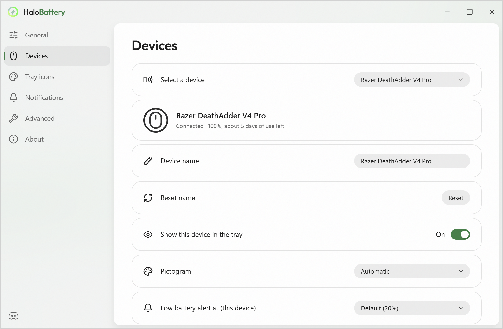
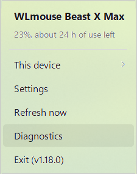

<picture>
  <source media="(prefers-color-scheme: dark)" srcset="docs/readme/hero-dark.svg">
  <source media="(prefers-color-scheme: light)" srcset="docs/readme/hero-light.svg">
  
</picture>

Battery levels of your wireless mouse, keyboard, headset and controller, 
right in the Windows tray. No vendor software.

<a href="https://github.com/HeyOkay/HaloBattery/releases/latest"><b>Download for Windows</b></a>
&nbsp;·&nbsp; <a href="https://halobattery.app">Website</a>
&nbsp;·&nbsp; <a href="https://discord.gg/K796KR9xtk">Discord</a>
&nbsp;·&nbsp; <a href="README.ru.md">Русский</a>
&nbsp;·&nbsp; <a href="README.zh-CN.md">简体中文</a>

<picture>
  <source media="(prefers-color-scheme: dark)" srcset="docs/readme/taskbar-dark.webp">
  <source media="(prefers-color-scheme: light)" srcset="docs/readme/taskbar-light.webp">
  
</picture>

Every wireless device gets its own small ring in the tray. The ring empties as the
battery drains, turns amber when it gets close to your alert level and red below it,
and glows green while the device charges. Hover an icon for the exact percentage and
how long the battery should last. Double-click it to open that device's settings.

Halo Battery reads the level straight from the 2.4 GHz receiver, the USB cable or
Windows Bluetooth, so Synapse, G HUB and the other vendor apps can stay closed.

<picture>
  <source media="(prefers-color-scheme: dark)" srcset="docs/readme/devices-dark.svg">
  <source media="(prefers-color-scheme: light)" srcset="docs/readme/devices-light.svg">
  
</picture>

A few more things it does:

- Works with Razer, Logitech, SteelSeries, HyperX, Corsair, ASUS, Sony, Xbox, 8BitDo,
  Pulsar and many more. The [device list](docs/devices.md) shows which ones have been
  tested on real hardware.
- Lets you set the name, the icon and the alert level for each device. Any icon from
  [Iconify](docs/iconify.md) works too.
- Holds alerts back while a full-screen game is open.
- Updates itself from the tray menu.
- Speaks 11 languages and follows the Windows light or dark theme.

Everything else is in [Features and settings](docs/features.md).

## Settings

<picture>
  <source media="(prefers-color-scheme: dark)" srcset="docs/readme/settings-dark.png">
  <source media="(prefers-color-scheme: light)" srcset="docs/readme/settings-light.png">
  
</picture>

## Install

Get the files from the [latest release](https://github.com/HeyOkay/HaloBattery/releases/latest). Windows 10 or 11, 64-bit.

| File | |
| --- | --- |
| `HaloBattery-<version>-setup.exe` | The installer. Installs for your user account only, no administrator rights needed. |
| `HaloBattery-<version>.zip` | Portable. Extract the whole archive to its own folder and run `HaloBattery.exe`. |

`SHA256SUMS.txt` in the same release lists the checksums. Newer test builds are marked
**Pre-release** on the [releases page](https://github.com/HeyOkay/HaloBattery/releases);
they may have bugs. To run from source, see [Run from source](docs/features.md#run-from-source).

## My device isn't listed

Send a diagnostics report. It takes about a minute:

1. Close the maker's software (Synapse, G HUB, the web driver and so on) and wake the
   device up by moving the mouse or pressing a key.
2. Right-click a Halo Battery icon and choose **Diagnostics**. The "No devices found"
   icon has this item too.

   <picture>
     <source media="(prefers-color-scheme: dark)" srcset="docs/contributing/diagnostics-menu-dark.png">
     
   </picture>

3. `diagnostics.txt` opens in your text editor. [Open an issue](../../issues/new?template=device.yml),
   say what the device is and how it is connected (receiver, cable or Bluetooth), and
   drag the file into the comment box.

The report contains Bluetooth MAC addresses and serial numbers. Replace them with `xx`
if you like before posting. [CONTRIBUTING.md](.github/CONTRIBUTING.md) covers the report
in detail, how to record a USB capture of the maker's app, and how to send a pull request.

<b>Troubleshooting</b>

- **No level shows up.** Close Synapse, the WLmouse web driver and other battery tools,
  since they can hold on to the receiver. Wake the device. If it uses a USB receiver,
  unplug it and plug it back in. If that doesn't help, send a diagnostics report.
- **"python312.dll was not found", or Start with Windows says the app runs from a
  temporary folder.** The app was started from inside the ZIP, or only `HaloBattery.exe`
  was copied out of it. Extract the whole ZIP to its own folder and run it from there.

Settings, the log and the diagnostics report are in `%APPDATA%\HaloBattery`, or next to
the app in [portable mode](docs/features.md#portable-mode). The `data folder:` line at
the top of the diagnostics report shows which one is in use.

## Thanks

Device protocols come from [OpenRazer](https://github.com/openrazer/openrazer),
[HeadsetControl](https://github.com/Sapd/HeadsetControl), [Solaar](https://github.com/pwr-Solaar/Solaar),
[rivalcfg](https://github.com/flozz/rivalcfg), [G-Helper](https://github.com/seerge/g-helper) and other
open projects, and from the captures and test runs people send in. [Full credits](docs/credits.md).

If Halo Battery saves you from installing a vendor app, you can support it on
[Ko-fi](https://ko-fi.com/halobattery) or [PayPal](https://paypal.me/hellobattery).
Questions and device requests are welcome on [Discord](https://discord.gg/K796KR9xtk).

[MIT license](LICENSE) · [Code-signing policy](docs/code-signing.md) · [Privacy](docs/privacy.md)
